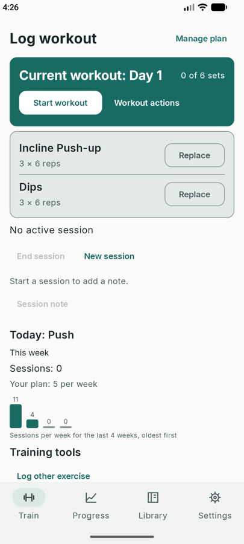
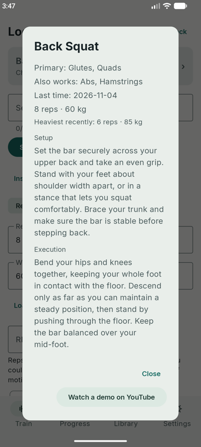
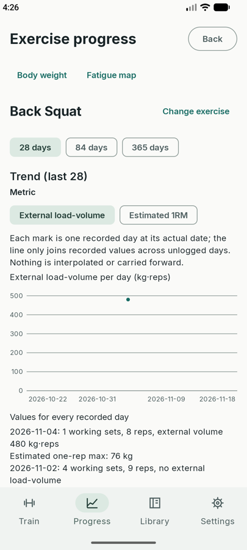

<p align="center">
  
</p>

<h1 align="center">HydraFit</h1>

<p align="center">
  A free, open-source strength training app for Android that works fully offline.
</p>

<p align="center">
  <a href="https://github.com/Hydraxon91/HydraFit/releases/latest"></a>
</p>

<p align="center">
  
  &nbsp;
  
  &nbsp;
  
</p>

HydraFit plans your training week, helps you log sets without fuss, and shows how things are going. It never asks for an account, a subscription or an internet connection.

It's a solo project that I use myself, so it grows around real training. You can [download the latest signed APK](https://github.com/Hydraxon91/HydraFit/releases/latest). It isn't on an app store yet, and it needs Android 7.0 or newer.

## What it's like to use

**Train.** Open the app and you land on today's workout. Tap an exercise's name to see what it works, what you did last time and your heaviest recent set, how to set up and perform it, and a hand-picked demo video when there is one. Log sets in a few taps, with rest prompts and warm-up ramps if you want them. A small weekly summary shows how many sessions you've done. It has no streaks, no targets and no guilt: a quiet week is just an empty bar.

**Plan.** Answer a few questions about your equipment, your goal and the days you train, and HydraFit builds a weekly plan on your device. Prefer to run your own routines? Build them yourself, schedule them on chosen weekdays or just work through them in order. Suggested weights come from your own history and your own records, with progression and a deload week built in.

**Progress.** See each exercise's trend over 28, 84 or 365 days, your records, your body weight over time, and a body map of which muscles you have been working. Where the app is estimating something, such as fatigue, it says so plainly.

**Your data stays yours.** Everything lives on your phone. Back it up and restore it locally. Edit any built-in exercise or add your own. There is no tracking.

## The details

### Plan your training

- Set up on first launch, or any time from Settings: pick your unit, equipment and training goal, choose your usual training days, and optionally record best sets you already know. Every step is optional and can be skipped or revisited, and setup never writes workout history.
- Generate a plan for 2–6 days a week using Full Body, Upper-Lower or Push-Pull-Legs splits. A five-day week trains upper, lower, push, pull and legs, and a four-day week alternates upper and lower. Set your equipment and weight limits, choose exercise preferences, or exclude exercises you don't want to use.
- Keep more than one equipment profile, for example home and the gym, each with its own equipment, weight limits and loading setup (plates you own, bars with their collar weight, and fixed or adjustable dumbbells). Work out which plates to load for a target weight, or the nearest weight you can actually reach. The calculator only calculates: it never changes what you log or your plan.
- Build, reorder, duplicate and archive your own routines. Schedule a routine or generated plan on chosen weekdays, or work through it as a next-workout sequence. Missed workouts stay pending until you finish or skip them.
- Get suggested working weights from your logged history or manual personal records, with automatic progression and a deload week in each four-week cycle.

### Log your workouts

- Record reps, weight in kg or lb, optional reps in reserve (RIR), warm-ups and bodyweight sets. Quick-fill from recent sets, backdate a workout, or correct a saved set's time, reps, weight and RIR.
- Turn on guided logging and editable rest prompts if you want them. Background alerts and short-rest coaching are separate, off-by-default options; Android power management can delay alerts.
- In guided workouts, use optional preparation checklists and editable ramp-set suggestions based on your planned loads and equipment limits. Recorded ramps stay warm-ups: they don't count toward working-set progress or start a rest timer.
- Read short offline setup and execution guidance for every seeded exercise (195 at this release). The text is bundled with the app and needs no network. An exercise without authored guidance shows an explicit unavailable state instead of generic advice.
- Watch a demo. For 45 common exercises the demo button opens a hand-picked YouTube video; for the rest it opens a YouTube search. Nothing is requested until you tap, and the app hosts no video itself.
- Read optional technique considerations for Conventional Deadlift, Romanian Deadlift and Dumbbell Romanian Deadlift in the same viewer. These are reminders, not an injury-risk rating or medical advice.
- Replace an untouched scheduled exercise for today's workout without changing your routine or future workouts. Start or end sessions explicitly when you need to.
- Long-press the app icon and choose **Train** to jump straight to the Train tab. It only opens the tab and never starts a workout.

### See your progress

- Open Exercise Progress to see per-exercise trend charts for 28, 84 or 365 days, all-time records with the sets that produced them, and the full recorded history. It only reads: nothing is written.
- Open Body weight from Progress to record one measurement per day, set an optional goal, and see 4-, 12- or 52-week charts. If you log chin-ups or pull-ups and pulldowns, it also shows how your pulldown level compares with your chin-up level. That is for information only and never changes your plan.
- View a per-muscle fatigue heatmap and an offline anatomical body map with Male/Female and Front/Back views, plus performed coverage (seven-day working-set counts, estimated involvement credits and last-trained dates). The fatigue index is a planning estimate, not a measurement of recovery or readiness.

### Keep your data yours

- Edit built-in exercises or add your own, including equipment, movement patterns and muscle involvement.
- Back up and restore your data locally. Core planning and logging work offline; AI options are never required.
- Android backup leaves out your Groq key and your automatic-backup folder setting, since neither can work on another device.
- Read the complete bundled third-party notices offline from Settings → About → Open-source licenses. HydraFit's own source is MIT; libraries, fonts, data and artwork keep their own terms.

## Download and build

Signed Android APKs are on the [releases page](https://github.com/Hydraxon91/HydraFit/releases). For a local debug build, you need JDK 17+ and the Android SDK:

```bash
git clone https://github.com/Hydraxon91/HydraFit.git
cd HydraFit
./gradlew :androidApp:assembleDebug
```

Android Studio can help set up the SDK. See the [project reference](docs/agent-project-reference.md) for configuration and test commands. Cloud planning is optional: get your own Groq API key and enter it in Settings. Usage is subject to your Groq account's limits and charges.

Use debug builds on a development emulator, not signed or minified release APKs. Publishing and signing instructions live in the [release guide](docs/agent-ci-release.md).

## Where it's heading

HydraFit is a pre-1.0 project. The series through 0.15 has shipped: workout context, progress and recovery, equipment and data, progression, other training metrics, optional AI and a visual polish pass. What is left before 1.0 is mostly checking things on real phones, smaller improvements, and a verified release.

iOS and desktop versions are not planned. HydraFit is a mobile app for Android; the iOS build target only stays to keep shared code honest.

See the [open items](docs/open-items.md) for what's still on the list, the [roadmap](docs/roadmap.md) for how releases are grouped, and [PLANS.md](PLANS.md) for execution status.

## Planner options and current limitations

The **built-in deterministic planner** is the default. It runs offline and produces the same plan from the same inputs. Equipment, exercise preferences, fatigue estimates, load history and training goals inform its choices. Its calculations and tradeoffs are documented in the [architecture](docs/architecture.md) and [fatigue formula](docs/fatigue-formula.md).

One optional AI engine uses the same planning interface:

- **Groq API:** needs your own API key and a network connection. It sends equipment, fatigue and goals to Groq; sharing logged workout history requires a separate consent toggle, off by default. Groq's rate limits, charges and data policies apply. Generated plans are validated but may still need your review.

Some older plans also contain loads whose meaning was never established. The Logger labels these as "recorded, unconfirmed" rather than rewriting them. Generated bodyweight prescriptions do not suggest external loads; added kilograms are treated as added load, not total resistance.

## Development

HydraFit uses Kotlin Multiplatform and Compose Multiplatform, with SQLDelight for local storage, Koin for dependency injection and Ktor for the optional Groq planner. Android is the only shipping platform; an iOS compile target is kept locally to catch shared-code mistakes, and there is no iOS or desktop app.

Domain logic lives in `core/domain`, storage and engine integrations have their own core modules, and each feature owns its UI and navigation. `shared` connects them; `androidApp` is the Android entry point. See the [architecture guide](docs/architecture.md) for the boundaries.

I develop this project with substantial help from AI coding agents, including [OpenCode](https://opencode.ai). The project rules in [AGENTS.md](AGENTS.md) cover scope, testing, approvals and code review. CI checks lint, host tests, migrations and Android builds; iOS compilation runs locally at the release integration gate. Release tags produce signed APKs.

## Credits

Built by [Hydraxon](https://github.com/Hydraxon91/HydraFit).

The anatomical body-map artwork is adapted from [MuscleMap](https://github.com/melihcolpan/MuscleMap)
by Melih Colpan and [react-native-body-highlighter](https://github.com/HichamELBSI/react-native-body-highlighter)
by ELABBASSI Hicham, both MIT-licensed. Both notices are bundled with the artwork in
[`LICENSES.txt`](feature/fatigueheatmap/src/commonMain/composeResources/files/bodymap/LICENSES.txt).
Muscle boundaries are schematic; colours represent estimated fatigue, not measured physiology.

Exercise catalog metadata (names, muscle targets, equipment, mechanics) is derived from [yuhonas/free-exercise-db](https://github.com/yuhonas/free-exercise-db) (Unlicense, public domain), with muscle classification cross-checked against [ExRx.net](https://exrx.net) facts. The per-muscle involvement weights are HydraFit model parameters calibrated against the following surface-EMG systematic reviews (cited as sources of facts; no text or figures reproduced):

- Krause Neto et al. (2020), *Gluteus Maximus Activation during Common Strength and Hypertrophy Exercises: A Systematic Review*, Journal of Sports Science and Medicine 19(1):195–203.
- Martín-Fuentes, Oliva-Lozano & Muyor (2020), *Electromyographic activity in deadlift exercise and its variants. A systematic review*, PLoS ONE 15(2):e0229507.
- Martín-Fuentes, Oliva-Lozano & Muyor (2020), *Evaluation of the Lower Limb Muscles' Electromyographic Activity during the Leg Press Exercise and Its Variants: A Systematic Review*, IJERPH 17(13):4626.
- Oliva-Lozano & Muyor (2020), *Core Muscle Activity during Physical Fitness Exercises: A Systematic Review*, IJERPH 17(12):4306.
- García-Valverde et al. (2025), *Electromyographic activity of the lower limb muscles during squat exercise and its derivatives: a systematic review with meta-analysis*, Cultura, Ciencia y Deporte 20(66):2261.

No exercise media is bundled. Full source and provenance notes are in [`docs/exercise-catalog-sources.md`](docs/exercise-catalog-sources.md).

History search folds Unicode case using the Unicode Character Database case-folding data (Unicode 17.0.0, `CaseFolding.txt`), copyright © Unicode, Inc., distributed under the Unicode License v3.

## License

HydraFit's source is [MIT-licensed](LICENSE). Exercise-data provenance is documented above; optional model weights and runtime components have their own terms.
