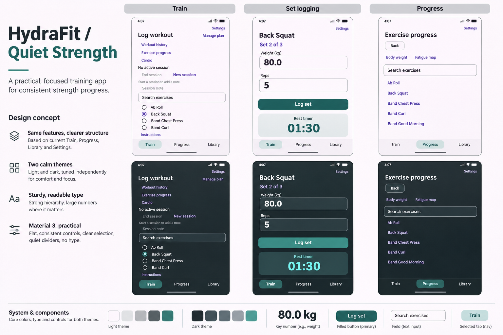
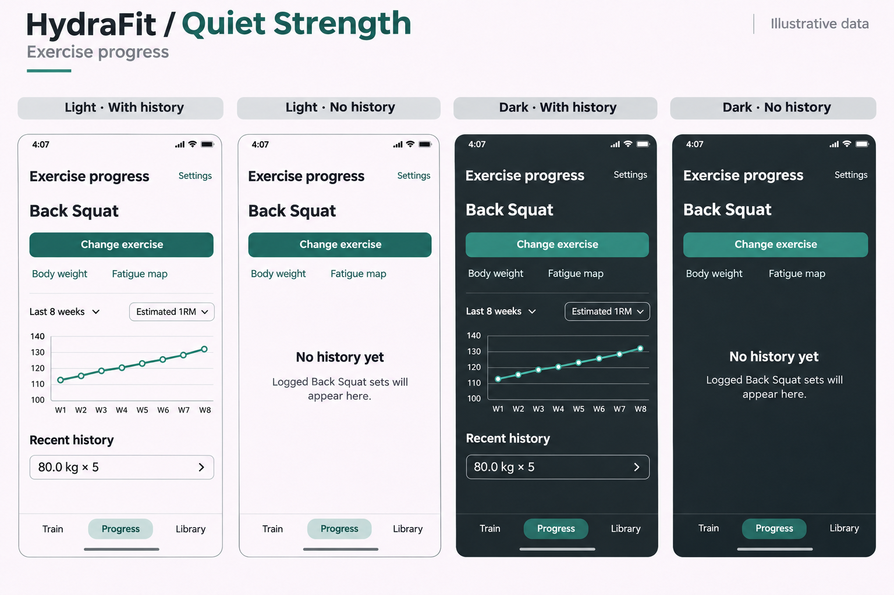

# 0.13.4 design proposal — Quiet Strength

**Status:** Implementation scope approved, 2026-11-04, under PLANS.md's 0.13.4
contract. The user delegated exact token selection and authorized both chart
metrics, independent review and in-scope mechanical corrections within a four-hour
budget. Publication remains separately gated. Implementation/verification status
is recorded in PLANS.md and docs/qa.md, not inferred from these concepts.

## Approved reference authority and exact tokens

The six latest boards in `design/0.13.4/` supersede the two initial exploration
boards for actual screen composition:

- `HydraFit quiet strength progress board-1.png`
- `HydraFit quiet strength training library board-2.png`
- `HydraFit Quiet Strength Tablet UI Board-4.png`
- `HydraFit editors_ light and dark phone states-3.png`
- `HydraFit quiet strength workout flow-2.png`
- `HydraFit Progress & Library UI Board-1.png`

The user-approved chart extension adds an External load-volume / Estimated 1RM
selector. Initial metric is volume; preserve 28/84/365-day ranges, dated markers
and existing station filtering. User amendment 2026-11-04: straight lines join
consecutive recorded observations across unlogged dates; dots mark measured values,
and no daily value, zero or forecast is fabricated. Volume has a zero baseline and
kg·reps/lb·reps labels; estimates have clearly labelled padded automatic kg/lb
bounds. Reuse existing daily calculated values, retain selection within the
ViewModel lifetime, and provide metric-specific empty states plus an accessible
numeric equivalent. See PLANS.md for the full contract.
The historical alternatives below describe the original proposal, not an open
decision or permission to implement any earlier, different concept.

Selected semantic tokens (hex sRGB; no gradients):

| Role | Light | Dark |
| --- | --- | --- |
| Canvas | `#FAFAF8` | `#182326` |
| Surface | `#F0F3F1` | `#223135` |
| Grouped surface | `#E3E9E6` | `#2B3B3F` |
| Main text | `#182326` | `#F2F6F4` |
| Supporting text | `#4B5C5D` | `#BAC9C5` |
| Primary | `#176B63` | `#79D5C5` |
| On primary | `#FFFFFF` | `#073B35` |
| Outline | `#748381` | `#839894` |

Computed WCAG sRGB contrast: light text/canvas 15.37:1, supporting/surface
6.29:1, on-primary/primary 6.33:1, outline/canvas 3.79:1; dark text/surface
12.36:1, supporting/grouped surface 6.80:1, on-primary/primary 7.20:1 and
outline/surface 4.42:1. These are the named base pairs only, not verification of
all resolved component roles, opacity states or rendered pixels. Complete theme
role coverage and rendered evidence remain required. Dark primary buttons use
dark labels rather than blindly copying white labels from the generated boards.

Use the existing sans-serif with 24sp screen titles, 22sp exercise headings,
18sp section headings, 16sp body/inputs, 14sp supporting text, 32sp active numeric
values and 40sp timers where the existing component exposes those roles. The rest
timer uses the 32sp `displaySmall` role rather than the 40sp `displayMedium` start
value: the larger timer would force extra wrapping in the compact workout column,
so the deviation is recorded here rather than left implicit. Preserve
font scaling; use 8dp field and 12dp section/button corners, a 4/8/12/16/24/32dp
spacing rhythm and at least 48dp interactive targets. Do not alter platform keyboards.

## 1. Direction and scope

Combine the **Quiet Strength visual identity** from the first board with the
**exercise-first Progress hierarchy** from the second board. Use graphite and teal,
clear typography, readable workout numbers and restrained surfaces to make HydraFit
feel like a dependable training tool rather than a promotional fitness dashboard.

The [0.13.4 roadmap](roadmap.md)
already covers palette, typography, surfaces, shapes and consistent component
styling. It requires approved visual proofs before integration. The specific
direction and refinements here remain proposals, not recorded user acceptance.

This is a bounded visual pass, not a replacement of the current application:

- Preserve training, planning, logging, persistence, backup and unit semantics.
- Preserve Train / Progress / Library navigation, toolbar Settings access and
  existing Back behavior. Do not add duplicate Settings controls inside features.
- Keep the current workout-first Train experience and adaptive layouts.
- Preserve body-map artwork and neutral-to-red fatigue meanings.
- Do not introduce metrics, scores, social features, accounts or network needs.
- App icon, splash screen, new fonts/dependencies and shared-module changes are
  not authorized by these concepts and need their own applicable decisions.
- Do not use this design work to close unrelated 1.0-readiness or verification debt.

## 2. Reference boards

These are image-generator concepts supplied by the user, with illustrative data.
They establish visual intent, not exact pixels, supported capabilities or measured
accessibility. The PNGs are preserved unchanged; the copies in Downloads remain
untouched. The boards are references, not production artwork to bundle into the app.

### A. Identity and component direction

Original filename: `HydraFit quiet strength app concept board.png`.

Take the graphite/teal relationship, strong workout numerals, restrained surfaces,
primary-action treatment and distinct rest-timer area. Do **not** take the manual
exercise-list Train layout as the specification for an active workout, the
exercise-picker-only Progress layout, leftover purple links, gradients, glows or
iOS-style device chrome.

### B. Progress composition and empty state

Original filename: `HydraFit progress screens_ quiet strength.png`.

Take the sequence of exercise context, range/data controls, prominent trend and
history, plus the calm empty-state treatment. Refine the oversized Change exercise
button and excessive header space. The depicted metric selector, eight-week range,
connected line and history chevrons are not proof of existing functionality.

## 3. Design goals

| Goal | Observable result |
| --- | --- |
| Quiet strength | Clear hierarchy and restrained colour; no decorative dashboard, hype, glow or unnecessary animation. |
| Obvious next action | Start/Resume workout or the relevant set action leads its task context; secondary navigation does not compete. |
| Readable numbers | Load, repetitions, measures, set position and timers are easy to distinguish and retain visible units/context. |
| Consistent components | The same control role has the same appearance across features and themes. |
| Intentional light and dark | Both themes have distinguishable surfaces, readable supporting text and measured contrast. |
| Real-use resilience | Long names, large text, localized numbers, the keyboard and wide windows do not hide information or actions. |

## 4. Proposed visual system

### Colour roles

Define semantic roles through the existing Material theme, not local hex values
scattered across screens. These are palette targets; **exact colour values are not
yet sampled, approved or contrast-verified**.

| Role | Light target | Dark target |
| --- | --- | --- |
| Canvas | Soft neutral off-white, without the board's incidental pink cast | Deep graphite with a restrained green undertone |
| Surface | Near-white or lightly tinted neutral | Slightly lighter graphite, distinguishable from canvas |
| Grouped/emphasized surface | Subtle grey-green | Muted raised graphite/teal |
| Main text | Near-black graphite | Soft near-white |
| Supporting text | Readable slate | Readable pale grey-green, not faint grey |
| Primary action | Deep teal | Teal chosen together with its contrasting label colour |
| Selected container | Pale teal with dark teal content | Muted teal with contrasting content |
| Outline/focus | Visible neutral/teal boundary | Visible grey-green boundary |
| Error/destructive | Explicit error role, distinct from ordinary actions | Corresponding accessible dark-theme role |

Teal identifies actions, selection and appropriate chart marks. It does not mean
"recovered", "safe" or "good performance". Fatigue-map colours retain their
existing independent meaning. Error, selected, focus and disabled roles must not
accidentally inherit an unsuitable default purple treatment.

Use flat fills. Avoid gradients, glass, glow and ornamental shadows. Do not assume
white text works on every teal: the foreground and background are a tested pair.
Complete and check all Material roles consumed by the affected screens, not just
primary/background. Theme selection continues to follow existing system behavior;
this proposal adds no theme setting.

### Typography and numbers

Use the existing platform/system sans-serif initially; a new font is not necessary
to establish this identity. Define the hierarchy through Material typography.
The following are proof starting points, not fixed-height layout constraints:

| Use | Proposed starting size | Treatment |
| --- | --- | --- |
| Screen title | 24–28sp | Strong, but not a promotional headline |
| Exercise/workout heading | 22–24sp | Prominent; allow multiple lines |
| Section heading | 18–20sp | Consistent weight and spacing |
| Body/input label | 16sp | Normal readable content |
| Supporting label | 14sp | Never the only readable version of an important value |
| Active load/repetition value | 28–32sp | Strong numeric hierarchy with explicit labels/units |
| Timer | 36–40sp | Stable-width/tabular numerals where supported |

Keep entered text, decimal precision, localization and captured units unchanged.
Use tabular numerals where the existing font supports them; do not introduce a
font dependency solely for that feature. Never shrink text to force a mockup fit.

### Spacing, shape and surfaces

- Start with a 4/8/12/16/24/32dp spacing rhythm; retain appropriate existing insets.
- Use roughly 16dp compact outer padding, increasing only where the existing wide
  layout supports it. Do not change adaptive thresholds or content-width contracts.
- Explore modest corners: approximately 8dp for fields and 12dp for buttons or
  genuinely grouped sections. Selected navigation indicators can remain pill-shaped.
- Use typography, spacing and dividers before adding another card. A workout row,
  a section and an entire screen do not each need nested containers.
- Preserve at least 48dp interactive targets even where visible controls look compact.
- Keep critical actions reachable through scrolling and keyboard insets; do not
  invent a sticky action bar solely because it suits the concept image.

### Component hierarchy

| Component | Proposed treatment |
| --- | --- |
| Main task action | Filled teal, clear verb, visually dominant within that task |
| Secondary action | Outlined or text treatment; Change exercise is not a filled full-width primary |
| Destructive action | Explicit label and existing confirmation; distinct from primary teal |
| Input | Visible label, unit/context, focus boundary and inline validation |
| Filter | Clear selected state beyond colour; wrapping layout, not clipped labels |
| Navigation | Consistent selected container and readable labels; retain current shell behavior |
| Rest timer | Distinct, calm surface with readable state and existing controls |
| Loading/error | Consistent theme treatment without hiding the message or recovery action |
| Dialog | Clear title/scope, scrollable content and reachable Save/Cancel actions |

## 5. Screen composition

### Train — active workout overview

Restyle the actual current overview, not board A's fallback manual-entry screen.
Keep workout identity, completed/prescribed progress, Start/Resume workout and the
exercise prescriptions prominent. Preserve the Workout actions menu, occurrence-only
replacement and access to Other training. Do not promote manual session controls
above the active workout or turn presentation changes into workout writes.

The no-active-workout/manual-entry and accepted-plan-without-a-block flows must
remain usable. This document does not resolve their outstanding product questions,
create a block automatically or remove manual/batch logging.

### Train — focused set logging

Carry over the large numeric hierarchy and timer treatment from board A while
preserving all controls required by the actual logging context:

- Exercise name, set position and target versus entered/performed values.
- Appropriate load, reps, duration, distance, force and other applicable fields;
  the example's weight/reps form is not a universal form.
- Existing guided, draft, warm-up, cluster and superset context/actions.
- Existing rest and timed-set controls, saving guards, errors and retry behavior.

The rest area must not obscure an active editor. Rest expiry stays distinct from
set completion and retains its existing explicit dismissal behavior. Do not make
a timer disappear, auto-save a set or advance the workout to match the mockup.

### Progress — compact selected-exercise view

Proposed reading order:

1. Compact page heading, existing Back affordance where applicable, shell Settings.
2. Prominent selected exercise and a secondary Change exercise control. Keep them
   adjacent where space permits; stack/wrap when text or window size requires it.
3. Compact secondary access to Body weight and Fatigue map.
4. Existing range controls and applicable station filter, clearly scoped.
5. Range trend, explanatory context and accessible numeric equivalent.
6. All-time records with their existing supporting-set access.
7. Recorded history and its existing paging/recovery controls.

Bring the trend forward without removing information to imitate the board's
sparse contents. No fixed requirement that everything fit above the fold at large
text sizes. Avoid a large full-width Change exercise button and redundant headers.

Preserve these distinctions:

- No selected exercise: show the existing inline search/selection experience;
  do not silently select Back Squat or the most recent exercise.
- Compact selected view: preserve the picker dialog and its query behavior.
- Wide view: preserve the existing side-by-side picker and detail layout.
- Range-local trends are not all-time records or paged all-time history.
- No eligible chart data does not imply no recorded history. Warm-up-only or
  non-chartable work must not disappear behind a global "No history yet" state.
- Chart, history, supporting-set and load-more failures retain their independent
  recovery controls; a chart failure must not erase otherwise available history.

Use meaningful date/unit labels wherever presented and retain the accessible
numeric table. Do not introduce row navigation merely to reproduce the board's
chevron. Adding dates or detail interactions to existing history rows must be
specified separately if it changes their current presentation contract.

### Important chart decision — not a palette change

At the inspected source snapshot, Progress renders **external load-volume marks**,
not the illustrated selectable estimated-1RM line chart. Its explicit ranges are
**28, 84 and 365 days**, not eight weeks. Missing observations are not connected,
interpolated or drawn as fake zero days. Daily estimated-1RM data already exists in
`ProgressDay`, but there is no metric-selector state in `ProgressUiState`.

Two possible scopes need a user decision before an implementation plan treats
either as settled:

- **A — styling/composition only:** retain current chart metric, mark semantics,
  ranges and accessible table, applying the new identity and clearer hierarchy.
  This is the smaller visual scope, but does not reproduce board B's chart.
- **B — explicitly expand the chart presentation:** introduce selectable supported
  metrics and/or the illustrated trend treatment. Specify metric choices, default,
  units, eligible observations, missing-day/connection meaning, ranges, accessible
  values and selection continuity. Existing daily data may be reusable; that does
  not make these behavioral choices automatic or authorize calculation changes.

Neither option is selected by creating this document. A line showing estimated
strength also must not imply validated readiness or forecast future performance.

### Remaining screens

Apply the approved identity consistently to Library/Routines, Manage plan,
Equipment, Body weight, Settings, onboarding, instruction views and existing
dialogs/recovery screens. Preserve their current hierarchy and behavior unless a
specific composition change is separately proposed and approved. Keep disclosures,
validation, provenance, warnings, destructive confirmations and errors visible.

## 6. Adaptive layout, accessibility and UI states

- Preserve the current bottom-bar/rail behavior and Train/Progress pane eligibility.
  A wider layout must not start training or trigger any write.
- Preserve query, selected exercise, range, station filter, editor intent, meaningful
  scroll position, drafts and timer continuity through existing resize transitions.
- Recheck both themes at normal and 2.0 text scale, compact width, short height,
  keyboard-open layouts and representative wide layouts.
- Measure normal text at 4.5:1, large text at 3:1 and meaningful control/focus
  boundaries at 3:1 where applicable. Validate actual resolved colours, including
  overlays/states; a concept image or Material defaults are not measured evidence.
- Preserve semantic names, roles, focus/traversal and readable non-colour values.
  Screenshots do not prove focus order or successful interaction.
- Cover relevant first-run, empty, insufficient-data, loading, failure, retry,
  cancellation, saving and disabled states. An empty-state proof is not evidence
  for the other states. Do not invent asynchronous states for static content.
- Keep all user-facing copy in shared resources and reuse existing strings and
  presentation helpers. Check long names and localized decimal/date/unit content.

## 7. Additional screenshots to refine

Provide actual app screenshots with sample data, not personal notes or records.
Keep the underlying state/content comparable when requesting light/dark variants.
These are requested reference/proof inputs, not screenshots captured by this task.

| Priority | Screenshot | What the generator should refine/preserve |
| --- | --- | --- |
| 1 | Current active-block Train overview | Workout-first hierarchy, progress, prescriptions, Start/Resume and workout actions |
| 2 | Focused training, then rest running | Actual target/set controls, context and timer actions; do not simplify to weight/reps only |
| 3 | Populated Progress with station options, records and history | Fit the new hierarchy around actual information, not only the concept's chart and single row |
| 4 | Complex set-edit dialog with keyboard open | Labels, units, validation, scrolling and reachable Save/Cancel |
| 5 | Wide/tablet Train and/or Progress | Existing useful panes and rail, not an enlarged phone layout |
| 6 | Routines or Manage plan | Validate that identity works for denser lists and secondary actions |
| 7 | Genuine empty and recoverable-error states | Preserve explanatory copy and recovery actions without decorative filler |

Suggested refinement instruction:

> Apply the attached Quiet Strength graphite/teal identity to these real HydraFit
> screenshots. Preserve capabilities, controls, information, navigation and state
> meaning, but improve spacing, typography and hierarchy rather than tracing the
> current layout. Show flat Android/Material-compatible light and dark proofs with
> realistic text and touch targets. Keep secondary actions secondary, preserve
> errors/units/context, and add no unsupported metrics or interactions. Treat the
> supplied Progress chart as conceptual until its metric/range behavior is decided.

## 8. Approval and verification checkpoints

| Checkpoint | Required outcome | Current status |
| --- | --- | --- |
| Visual direction | User accepts identity, hierarchy and intentional departures from the boards | Approved; six latest boards authoritative |
| Chart scope | User explicitly chooses the presentation scope and resolves any added behavior | Resolved: both metrics, initial volume; straight connecting lines approved by amendment |
| Exact tokens | Light/dark colour pairs, type, shapes and component states specified and measured | Produced in this document; token-level contrast tests pass. Render sampling remains unverified |
| Representative proofs | Actual workout overview, logging/rest, Progress, dialog and adaptive examples approved before integration | Implementation and phone light/dark/2.0 proofs reviewed; tablet/foldable proofs remain unverified |
| Implementation plan | Exact files, implementation owner, tests, downstream checks, affected living docs and exclusions approved | Approved in PLANS.md; mixed main/DeepSeek ownership with local-correction authority |
| Post-styling acceptance | Fresh visual, semantic, adaptive and state evidence on the implemented candidate | Phone, tablet and unfolded-foldable light/dark/2.0 journeys passed for navigation, charts, Routines, pound display, keyboard-open editor and empty states. Fold/unfold posture transitions and fault-injected chart errors remain unverified |
| Review/release | Applicable independent/Plan-mode review, remaining readiness decisions and publication approvals | Independent review and targeted closure verified the code. The remaining cross-device, pound-display, Routines-specific and empty-state checks were run; TalkBack is permanently retired. Fold/unfold posture transitions and fault-injected chart errors remain unverified. Publication not approved |

Visual acceptance should compare the implemented screens with the approved role
hierarchy, not require pixel matching to generated images. Token/component checks
and existing regression tests must cover changed consumers; fresh theme, layout
and interaction evidence is required after styling. Earlier 0.13.1–0.13.3 evidence
does not verify a new palette or typography. Record outcomes and explicit limits
in `docs/qa.md` during the later approved implementation scope.

## 9. Source anchors and implementation boundaries

Source was inspected at HEAD `c72efff6f2b6b072f6fc6cebfe120baf2517a9d9`, with
pre-existing working-tree changes from the separate 0.13.2–0.13.3 batch. This is a
design-time snapshot, not a claim that the batch is finished or the files are a
stable implementation baseline. Re-establish the final baseline before planning
code changes. No batch-owned file is changed by this document task.

Starting points, **not an approved write set**:

- `shared/src/commonMain/kotlin/com/hydrafit/app/App.kt`: root Material theme,
  system theme selection, shell navigation and startup states.
- `feature/logger/src/commonMain/kotlin/com/hydrafit/app/feature/logger/WorkoutLoggerScreen.kt`:
  current workout-first and adaptive presentation; follow its existing components.
- `feature/progress/src/commonMain/kotlin/com/hydrafit/app/feature/progress/ProgressScreen.kt`:
  selected-exercise header, filters, chart/record/history sections and adaptive panes.
- `feature/progress/src/commonMain/kotlin/com/hydrafit/app/feature/progress/ProgressCharts.kt`:
  chart marks, missing-day semantics and accessible numeric table.
- `feature/progress/src/commonMain/kotlin/com/hydrafit/app/feature/progress/ProgressUiState.kt`:
  existing ranges, filters and independent load/recovery states.
- `core/domain/src/commonMain/kotlin/com/hydrafit/app/core/domain/workout/ExerciseProgress.kt`:
  available daily values and records; a source reference, not permission to change formulas.

Reuse existing Material components, resources and presentation utilities. Shared
styling must not create feature-to-feature dependencies or move feature logic into
the app shell. Any new cross-module seam, dependency or architectural change needs
an explicitly approved plan; the concepts do not require a new design-system module.

Related guidance: [roadmap](roadmap.md), [QA ledger](qa.md),
[UI verification procedure](agent-ui-verification.md) and
[project reference](agent-project-reference.md).
